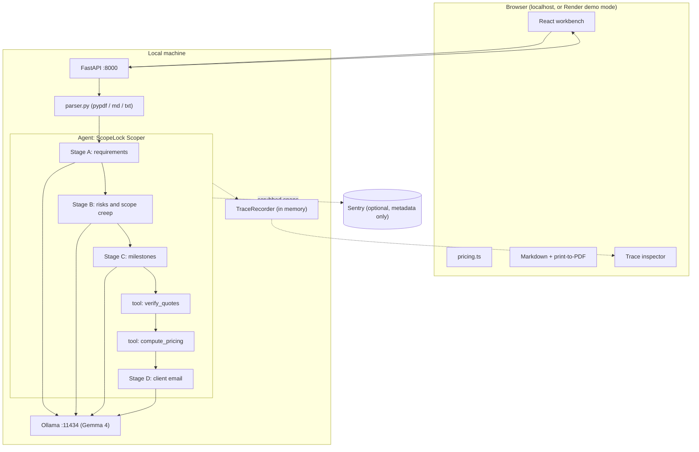

# ScopeLock: Architecture & Execution Plan (v2)
*An NDA-safe RFQ and proposal scoper for freelancers. Runs Gemma locally via Ollama, grounds every claim in the client's own words, does the pricing math in code, and traces the whole agent with Sentry (metadata only).*

---

## 0. Operating Rules for the Coding Agent (read first)

1. Work in the order of Section 11. Each gate has a **Done when** check. Do not start the next gate until the current one passes.
2. Use only the stack in Section 3. Do not add libraries, frameworks, or services that are not listed. If something is blocked, pick the simplest fallback listed in Section 14 and write the decision to `docs/devlog.md`.
3. **Never** log, print, trace, or send brief contents anywhere except the local API response. No `print(brief)`, no brief text in exceptions, no brief text in Sentry spans.
4. Never hardcode secrets. All config is read from env vars (`.env.example` lists them).
5. Commit early and often with meaningful messages. The git history is the proof that this project was built inside the challenge window.
6. Append a short entry to `docs/devlog.md` at every gate (what worked, what broke, real numbers). The DEV article is written from this file.
7. All sample briefs are **synthetic**. Never include real client material in the repo.
8. Do not invent metrics. Every number that appears in the README, UI, or article must come from `evals/results.md` or a Sentry trace.

---

## 1. Challenge Facts and Scoring Strategy

**Challenge:** Hacktoberfest Open-Source AI Challenge, Week 2, theme **Side Hustle**: *build something with open-weight models or open-source AI that someone would actually pay for.*

| Fact | Value |
| :--- | :--- |
| Deadline | **Oct 18, 2026, 11:59 PM PDT** = **Oct 19, 12:29 PM IST** |
| Our internal publish target | **Oct 19, 06:00 IST at the latest** (6+ hours of buffer) |
| Project rule | Must be a **new** project started and finished inside the window. Any commit after the deadline must be noted in the README |
| Tags | `devchallenge`, `hf26challenge` |
| Submissions | One per challenge. DEV post only |
| Judging | **Writing Quality (weighted most)**, Relevance to Prompt/Theme, Creativity, Technical Execution, Partner Tech (optional) |
| Bonus | "Bonus points if you land your first user." Let someone use it and report honestly |

**Submission template sections (the post must follow these):** What I Built, Demo, Code, How I Built It, Why Does Open Innovation Matter?, My Agent Session (optional), My First User (optional), Prize Categories.

### Categories we enter (only ones we genuinely use)

| Category | Prize | Evidence we will show |
| :--- | :--- | :--- |
| Best Use of Gemma | $200 | Gemma 4 running locally via Ollama; model swap by one env var; measured comparison across Gemma sizes |
| Best Use of Render | $200 | Front end hosted on Render (static site + recorded-run demo mode), deployed via `render.yaml` |
| Best Use of Sentry Agent Tracing | $100 | Real `gen_ai.*` spans in Sentry Agents view, setup, latency/tokens, one real debugging story with screenshots |
| Best Use of a .tech Domain | $100 | Live site on a free Hacktoberfest-claimed `.tech` domain, linked in the post |

**Deliberately not entered:** DigitalOcean (renting a GPU to run the model contradicts the local-first story). Entire/DevRelay only if the Antigravity session can actually be captured (stretch, Section 12).

### What actually wins (design for the judges)

| Criterion | What ScopeLock does about it |
| :--- | :--- |
| Writing Quality | Draft starts at hour 0 from `docs/devlog.md`; concrete scene, real numbers, one real failure and how Sentry exposed it |
| Relevance to theme | Clear buyer (freelancer/boutique agency), clear pain (unpaid scoping + NDA risk), first-user evidence |
| Creativity | Quote-grounded output, deterministic pricing, **egress canary test** that proves no brief text leaves the machine |
| Technical Execution | Multi-stage constrained-decoding pipeline, verification tools, evals, traces |
| Partner Tech | Correct Sentry GenAI conventions, Render blueprint, `.tech` domain |

---

## 2. Product

### The problem
Freelancers and small agencies burn hours every week turning vague client briefs into a scoped, priced, defensible proposal. Pasting those briefs into a cloud LLM can breach the client's NDA. So they either do it by hand or take the risk.

### The solution
ScopeLock reads a client brief (PDF, Markdown, or text) **entirely on the user's machine** and produces:
- Atomic requirements, each tied to an **exact quote** from the brief
- Technical risks with severity, mitigation, and a question to ask the client
- **Scope-creep warnings** (vague phrases) with ready-to-paste SOW clauses
- A milestone plan with hour ranges
- A **deterministic** price (hours x multipliers x rate + contingency + payment schedule), computed in code, never by the model
- A "questions before I quote" email draft for the client
- Exports: Markdown and print-to-PDF

### Why someone would pay (hypothesis to test with the first user, not a claim)
- Saves the unpaid scoping hours
- Makes NDA-safe AI usage possible at all
- Protects margin by flagging scope creep before signing
- Business model to test: free open-source core; paid "proposal pack" (PDF templates, SOW clause library, rate/multiplier presets) as a one-time purchase. Put a Tally/Google Form "I'd pay for this" link on the landing page and ask the first user directly what they would pay. Do not fabricate traction.

### Differentiators vs. "just paste it into a chatbot"
1. Brief never leaves the machine, and a test proves it (Section 6).
2. Every requirement and scope-creep flag carries a verbatim quote, verified by code.
3. Money math is deterministic and editable.
4. Outputs are the artifacts a freelancer actually sends: SOW clauses, clarification email, proposal.

---

## 3. Architecture and Fixed Tech Decisions

### 3.1 Privacy boundary (honest wording; use this exact framing everywhere)
- **Zero client-content egress.** Brief text and generated proposals never leave the machine.
- Optional Sentry telemetry carries **metadata only** (span names, durations, token counts, model name, validation status). It is off when `SENTRY_DSN` is empty. With Sentry off, ScopeLock runs fully offline.
- Do **not** use the words "air-gapped" or "100% zero egress" in the UI or article while Sentry can be enabled. Say "zero client-content egress" and "fully offline when telemetry is off."

```
+----------------------------------------------------------------------+
| YOUR MACHINE                                                         |
|  [Brief PDF/MD/TXT] -> [Parser] -> [Agent: Gemma via Ollama] -> [UI] |
|                                 |                                    |
|                         [Local TraceRecorder] -> Trace Inspector      |
+--------------------------------|-------------------------------------+
                                 | optional, scrubbed, metadata only
                                 v
                        [Sentry Agent Tracing]
```

### 3.2 System diagram



### 3.3 Stack (decided; do not re-litigate)

**Backend:** Python 3.11+, FastAPI, Uvicorn, Pydantic v2, `httpx` (async Ollama client), `pypdf` (BSD, keeps the repo permissively licensable; do **not** use PyMuPDF, it is AGPL), `sentry-sdk`, `pyyaml`, `pytest`, `pytest-asyncio`, `python-multipart`.

**Frontend:** Vite + React 19 + TypeScript, Tailwind CSS v4 (`@tailwindcss/vite`) only (no separate hand-written design system), Zustand, `lucide-react`. Exports are client-side: Markdown generator + print stylesheet for PDF (no `@react-pdf/renderer`).

**State:** Backend is stateless. The browser stores recent proposals in `localStorage` with JSON import/export. No SQLite.

**Model runtime:** Ollama.
- Default model: `gemma4:e4b` (Ollama's default Gemma 4 tag). Configurable via `SCOPELOCK_MODEL`.
- Size ladder: `gemma4:e2b` (low-end laptops), `gemma4:e4b`, `gemma4:12b`, `gemma4:26b`, `gemma4:31b`. Verify tags with `ollama list` and the Ollama library page; tags change.
- Fallback if Gemma 4 structured output misbehaves on the installed Ollama build: `gemma3:4b`. Record the reason in `docs/devlog.md`.
- Ollama must be a recent build (Gemma 4 needs a recent release). Check `ollama --version` at Gate 0.
- **Context window pitfall:** Ollama's default `num_ctx` is 4096 regardless of what the model supports, so long briefs get silently truncated. Always send `options.num_ctx` explicitly (`SCOPELOCK_NUM_CTX`, default 16384).
- Request shape: `POST /api/chat` with `stream: false`, `format: <JSON schema>`, `options: {temperature: 0, seed: 42, num_ctx: ..., num_predict: ...}`.
- Constrained decoding guarantees the output **matches the schema**, not that it is **true**. That is why Section 4 adds grounding checks.
- Ollama's response gives `prompt_eval_count`, `eval_count`, `total_duration`, `load_duration`, `eval_duration` (durations in nanoseconds). It does **not** give a total token count; compute `input + output` yourself.
- Keep per-stage schemas small and flat (avoid unions/`anyOf`; inline `$defs` if the grammar compiler complains).

**Licensing:** Repo under Apache-2.0 or MIT. Gemma 4 is reported as Apache-2.0; verify on `ai.google.dev/gemma` before stating it in the article.

---

## 4. Agent Pipeline

One agent, `ScopeLock Scoper`, runs five steps. Smaller, focused calls are more reliable on small local models than one giant JSON schema, and they produce a far more useful Sentry waterfall.

| Step | Kind | Input | Output | Notes |
| :--- | :--- | :--- | :--- | :--- |
| A. Requirements | LLM (chat) | Brief text | `RequirementsResult` | Each requirement has `source_quote` (exact substring) and `complexity_tags` |
| B. Risks | LLM (chat) | Brief + requirements | `RiskResult` | Risks, scope-creep warnings, assumptions, out-of-scope list |
| C. Milestones | LLM (chat) | Requirements + risks | `MilestonePlan` | Hour ranges per milestone, linked to requirement IDs |
| Tool: `verify_quotes` | Deterministic | All quotes | Grounding report | Normalized-substring match against the brief. Ungrounded items are flagged `grounded=false` and shown with a warning; never silently trusted |
| Tool: `compute_pricing` | Deterministic | Milestones, rate, config | `CommercialSummary` | Table-driven multipliers, contingency, payment schedule. The model never does arithmetic |
| D. Client email | LLM (chat) | Open questions + risks | `ClientEmail` | Subject + body listing clarification questions |

**Long briefs:** estimate tokens as `chars / 4`. If the brief exceeds ~60% of `num_ctx`, split by Markdown headings or page groups, run Step A per chunk, then merge and de-duplicate requirements in code. Show a "chunked" badge in the UI.

**Repair loop:** on `ValidationError` or JSON failure, retry up to 2 times, feeding back only the validation error message (never the brief again beyond what the prompt already contains). Each attempt is its own `gen_ai.chat` span with `scopelock.attempt`.

### 4.1 Schemas (`backend/schemas/proposal.py`)

```python
from enum import Enum
from typing import List, Literal
from pydantic import BaseModel, Field

class Severity(str, Enum):
    LOW = "LOW"; MEDIUM = "MEDIUM"; HIGH = "HIGH"; CRITICAL = "CRITICAL"

class RiskCategory(str, Enum):
    INTEGRATION = "INTEGRATION"; SECURITY = "SECURITY"; SCOPE_CREEP = "SCOPE_CREEP"
    PERFORMANCE = "PERFORMANCE"; LEGAL_COMPLIANCE = "LEGAL_COMPLIANCE"

class ComplexityTag(str, Enum):
    THIRD_PARTY_API = "THIRD_PARTY_API"; PAYMENTS = "PAYMENTS"; AUTH = "AUTH"
    COMPLIANCE = "COMPLIANCE"; REALTIME = "REALTIME"; MOBILE_RELEASE = "MOBILE_RELEASE"
    AI_ML = "AI_ML"; NONE = "NONE"

# ---- Step A ----
class Requirement(BaseModel):
    id: str = Field(description="R1, R2, ...")
    summary: str
    kind: Literal["FUNCTIONAL", "NON_FUNCTIONAL", "CONSTRAINT"]
    source_quote: str = Field(description="EXACT substring copied from the brief")
    complexity_tags: List[ComplexityTag]

class RequirementsResult(BaseModel):
    project_title: str
    one_line_summary: str
    stated_platform_or_stack: List[str]
    requirements: List[Requirement]

# ---- Step B ----
class TechnicalRisk(BaseModel):
    title: str
    category: RiskCategory
    severity: Severity
    description: str
    mitigation: str
    client_question: str
    requirement_ids: List[str]

class ScopeCreepWarning(BaseModel):
    vague_quote: str = Field(description="EXACT ambiguous phrase from the brief")
    why_dangerous: str
    suggested_sow_clause: str

class RiskResult(BaseModel):
    risks: List[TechnicalRisk]
    scope_creep_warnings: List[ScopeCreepWarning]
    assumptions: List[str]
    out_of_scope: List[str]

# ---- Step C ----
class Milestone(BaseModel):
    id: str = Field(description="M1, M2, ...")
    title: str
    objective: str
    deliverables: List[str]
    requirement_ids: List[str]
    hours_min: int
    hours_max: int
    depends_on: List[str]

class MilestonePlan(BaseModel):
    milestones: List[Milestone]

# ---- Deterministic output (NOT requested from the model) ----
class PaymentStep(BaseModel):
    label: str; percent: int; amount: float

class CommercialSummary(BaseModel):
    currency: str
    hourly_rate: float
    hours_min_adjusted: float
    hours_max_adjusted: float
    contingency_percent: int
    price_low: float
    price_high: float
    recommended_fixed_price: float
    payment_schedule: List[PaymentStep]
    multipliers_applied: List[str]

# ---- Step D ----
class ClientEmail(BaseModel):
    subject: str
    body: str

class GroundingReport(BaseModel):
    total_quotes: int
    grounded_quotes: int
    ungrounded_ids: List[str]

class ScopeLockProposal(BaseModel):
    model: str
    requirements: RequirementsResult
    risks: RiskResult
    plan: MilestonePlan
    commercial: CommercialSummary
    client_email: ClientEmail
    grounding: GroundingReport
```

### 4.2 Deterministic pricing (`backend/core/pricing.py` and `frontend/src/lib/pricing.ts`)
- Multiplier table in `backend/config/multipliers.yaml`, mirrored to the frontend. Starting defaults (editable heuristics, **not** empirical truths): `THIRD_PARTY_API 1.35`, `PAYMENTS 1.40`, `AUTH 1.25`, `COMPLIANCE 1.50`, `REALTIME 1.30`, `MOBILE_RELEASE 1.20`, `AI_ML 1.40`, `NONE 1.00`.
- A milestone's multiplier is the **max** (not product) of tags across its linked requirements.
- `adjusted_hours = hours * multiplier`; totals sum milestones; contingency default 20% (range 15–25%); `recommended_fixed_price = hours_max_adjusted * rate * (1 + contingency)`; `price_low` uses `hours_min_adjusted`, no contingency.
- Payment schedule default 30/40/30 (deposit / mid-point demo / final sign-off), editable.
- Currency and rate are user inputs (default USD, 120/hr). Include INR as a selectable option.
- The same logic exists in Python **and** TypeScript so editing works in the Render demo (no backend). Both are tested against shared golden cases in `tests/fixtures/pricing_cases.json`.

### 4.3 Prompting rules
- System prompt per step; short, imperative, with one tiny example of the exact JSON shape.
- Step A/B: "Copy quotes character-for-character from the brief. If you cannot find an exact quote, omit the item."
- Step C: hours must be integers; give a range; no prices.
- Ruthless scope dissection: expand casual requests ("login with Google and Apple") into real engineering work (OAuth flows, token refresh, Apple developer credentials, account merging) as separate deliverables.
- Never ask the model for totals, prices, or percentages.

---

## 5. Observability: Sentry Agent Tracing (correct conventions)

Sentry's manual-instrumentation docs define the span shape below. The v1 plan's `ai.model`, `ai.token_usage.*`, and `gen_ai.workflow` are **not** what the Agents view reads; using them would leave the dashboard empty. Reference: `https://docs.sentry.io/platforms/python/agent-tracing/manual-instrumentation/`.

### 5.1 Span hierarchy

```
invoke_agent ScopeLock Scoper        (op gen_ai.invoke_agent)
├── doc.parse                          (custom op; plain span)
├── chat gemma4:e4b  [requirements]    (op gen_ai.chat)
├── chat gemma4:e4b  [risks]           (op gen_ai.chat)   (+ retry spans if any)
├── chat gemma4:e4b  [milestones]      (op gen_ai.chat)
├── execute_tool verify_quotes         (op gen_ai.execute_tool)
├── execute_tool compute_pricing       (op gen_ai.execute_tool)
└── chat gemma4:e4b  [client_email]    (op gen_ai.chat)
```
Model and tool spans are **siblings** (end the model span before running a tool).

### 5.2 Required attributes (set when the span starts)
- Agent span: `gen_ai.operation.name="invoke_agent"`, `gen_ai.agent.name="ScopeLock Scoper"`, `gen_ai.pipeline.name="scopelock-scoping"`; span name `invoke_agent ScopeLock Scoper`.
- Chat spans: `gen_ai.operation.name="chat"`, `gen_ai.provider.name="ollama"`, `gen_ai.request.model=<raw model string>`, `gen_ai.agent.name`, `gen_ai.request.temperature=0`, `gen_ai.request.seed`; span name `chat <model>`.
- On completion: `gen_ai.response.model`, `gen_ai.usage.input_tokens` (= `prompt_eval_count`), `gen_ai.usage.output_tokens` (= `eval_count`), `gen_ai.usage.total_tokens` (sum).
- Tool spans: `gen_ai.operation.name="execute_tool"`, `gen_ai.tool.name`, `gen_ai.agent.name`; name `execute_tool <tool>`.
- Failures: set span status to error and `error.type` to a low-cardinality code (`schema_validation`, `json_parse`, `ollama_unreachable`).
- Custom attributes use the `scopelock.` prefix: `scopelock.stage`, `scopelock.attempt`, `scopelock.load_ms` (= `load_duration / 1e6`), `scopelock.num_ctx`, `scopelock.chunks`, `scopelock.grounded_ratio`, `scopelock.doc_chars`.
- Use the current API: `sentry_sdk.start_span(op=..., name=..., attributes={...})`. The old `description=` keyword is the wrong shape.
- Local models have no list price, so Sentry cost will be empty. See Sentry's "Send Custom Costs" docs and report `$0` marginal cost; in the article, separately show a clearly labeled counterfactual (tokens measured here x a closed API's current public list price, cited with date).

### 5.3 Privacy settings (this is also our NDA story)
```python
sentry_sdk.init(
    dsn=os.getenv("SENTRY_DSN") or None,     # empty => SDK is a no-op, fully offline
    traces_sample_rate=1.0,
    send_default_pii=False,                   # prompt/response content is treated as PII by Sentry
    include_local_variables=False,            # stack frames must not carry brief text
    max_request_body_size="never",            # uploads must not be attached to events
    before_send_transaction=scrub_transaction,
    before_send=scrub_event,
)
```
- Never set `gen_ai.input.messages`, `gen_ai.output.messages`, or `gen_ai.system_instructions`.
- `scrub_*` hooks drop any `gen_ai.input*`/`gen_ai.output*` keys defensively and replace the filename with a short hash.
- Never log brief content (Python logging can become Sentry breadcrumbs).

### 5.4 Local TraceRecorder (powers the in-app inspector)
- A context manager `traced(op, name, attributes)` wraps `sentry_sdk.start_span` **and** appends `{id, parent_id, name, op, start_ms, duration_ms, status, whitelisted attrs}` to an in-memory list (contextvar-based).
- `/api/v1/scope/analyze` returns this `trace` array. The UI waterfall renders from it. The browser **never** calls the Sentry API (that would need a token and add egress).
- Whitelisted attrs only: model, stage, attempt, token counts, load_ms, status.

### 5.5 Make the Sentry write-up real
Planned experiments (all recorded in `docs/devlog.md` with screenshots):
1. **Cold vs warm start:** `load_ms` on first call vs later calls.
2. **Context truncation bug:** run a long brief with default `num_ctx` and show missing requirements, then fix by setting `num_ctx` and show the trace difference.
3. **Retry rate:** count repair-loop spans per model size.
4. **Model ladder:** same 5 briefs on `e2b`, `e4b`, `12b` (whatever the hardware allows): latency, tokens, grounded ratio, retries.
Pick the most interesting one as the "how I debugged it" story. Take screenshots of Explore -> Agents and a trace waterfall.

---

## 6. Privacy Proof: the Egress Canary Test

`backend/tests/test_no_content_egress.py`:
1. Generate a unique canary string (e.g. `CANARY-<uuid>`), embed it in a synthetic brief at several places.
2. Init Sentry with a **capturing transport** (no network) and a fake DSN; run the full pipeline with a **mocked** Ollama response that echoes parts of the brief.
3. Serialize every captured event/transaction to JSON.
4. Assert the canary and any 8+ word window of the brief appear in **none** of them.
5. Also assert that with `SENTRY_DSN` unset, no outbound HTTP calls are made except to `localhost:11434` (patch `httpx`/`socket` in the test).

CI-style command: `pytest backend/tests/test_no_content_egress.py`. The README links to this test; the article quotes what it proves and what it does not (it proves the app's own telemetry path, not the OS).

**Privacy beacon (UI):** reads `/api/v1/health` and shows the *actual* state: `Offline: telemetry off`, or `Telemetry on: metadata only`. Never a hardcoded "zero egress" badge.

---

## 7. Frontend Spec (Vite + React 19 + Tailwind v4)

Aesthetic: dark slate/zinc, emerald for privacy state, amber for risk. Clean and fast, not elaborate.

### Priorities
**P0 (must ship):**
- `IngestionDropzone`: drag-drop `.pdf/.md/.txt` or paste text; extracted-text preview; token estimate; model/num_ctx indicator.
- `ProposalWorkbench`: left pane = brief with highlighted quotes (blue = requirement, amber = scope-creep, red = high/critical risk), grounded vs ungrounded marker; right pane tabs:
  - **Milestones**: editable hours/rate/deliverables; live price via `pricing.ts`; editable payment schedule.
  - **Risks**: severity filter, one-click copy of mitigation and client question.
  - **Scope Guard**: vague quote + SOW clause with copy button.
  - **Client Email**: editable draft, copy button.
- `PrivacyBeacon`: truthful state from `/health` (Section 6).
- `TraceInspectorModal`: waterfall from the returned `trace`, tokens, load time, retries.
- `ExportModal`: Markdown download + "Print / Save as PDF" (print stylesheet: clean typography, milestone table, risk appendix, signature block).
- Demo mode (`VITE_DEMO_MODE=true`): loads recorded runs from `public/demo/*.json`, disables upload, shows a banner (Section 8).

**P1 (if on schedule):** NDJSON stage-progress streaming (`stage_start`/`stage_end` events) with a progress stepper; localStorage history with JSON import/export; INR/EUR/USD switch.

**P2 (only if everything else is done):** dark/light toggle, keyboard shortcuts.

---

## 8. Deployment and the Hosted Demo

**Local (the real product):** `ollama serve`, `uvicorn backend.main:app`, `npm run dev`. A `docker-compose.yml` for the backend only is **optional** (Ollama stays on the host for GPU access). Docker is not on the critical path.

**Hosted showcase (Render + .tech):**
- Render **static site** from `frontend/`, built with `VITE_DEMO_MODE=true`. No backend, no cold starts, no GPU.
- `render.yaml` blueprint (build: `cd frontend && npm ci && npm run build`, publish: `frontend/dist`, SPA rewrite `/* -> /index.html`).
- Claim the free `.tech` domain at `hacktoberfest.com/my/promos` **in the first two hours** (DNS and verification take time), attach it in Render's custom-domain UI (follow Render's own DNS instructions; TLS is automatic, no Cloudflare needed).
- Candidate names: `scopelock.tech`, `getscopelock.tech`; take whatever is free.
- **Honest labeling:** the demo shows **recorded real runs**, produced by `scripts/record_demo.py` against local Gemma, with real trace data. Banner text: *"Recorded run from a local Gemma model. Run ScopeLock locally to analyze your own briefs."* Never present a replay as live inference.
- Landing page sections: hero + demo, "How the privacy claim is proven" (links to the canary test), "Run it locally in 3 commands", pricing/"I'd pay" form link, GitHub link.

---

## 9. Evals (source of every number in the article)

`evals/run_eval.py` runs the pipeline over `backend/tests/sample_briefs/` for each available model and writes `evals/results.md`.

**Briefs (all synthetic):**
1. Mobile MVP: "Instagram for Pets with in-app purchases"
2. Healthcare SaaS: telehealth intake with HIPAA language
3. Fintech web app: Stripe marketplace with split payouts
4. A rambling WhatsApp-style client message with contradictions (robustness)
5. A long multi-page RFP PDF (exercises chunking and `num_ctx`)

**Metrics:** schema-valid-on-first-try rate, retries per run, grounded-quote ratio, latency (total and per stage), tokens in/out, cold-start `load_ms`, requirement count, milestone hour totals.

**Tests:**
- `pytest` unit tests with a **mocked** Ollama client (fast, deterministic): schemas, pricing golden cases, quote verification, chunk-merge, repair loop, canary test.
- A separate **live** eval (slow, needs Ollama) that is *not* part of the unit suite.
- Do not claim estimate "accuracy" without ground truth. The first user's own hand estimate of the same brief is the only honest comparison available.

---

## 10. First-User Plan (bonus points)

Goal: one real freelancer or small-agency person uses it on a (consented, sanitized) real brief and gives honest feedback.

- **By Gate 2 (about hour 18):** have a working local run on at least one brief. Send it to 3–5 people who scope work (freelancer friends, seniors, college club alumni, freelancing communities). Offer to run it with them on a call.
- Ask them to estimate the same brief by hand first (time + hours), then compare with ScopeLock.
- Capture, with permission: time saved, what they edited in the milestones, which flagged risk was new to them, what they asked for next, and **whether they would pay and how much**.
- If nobody uses it in time, **delete the "My First User" section**. Do not invent or embellish testimonials.

---

## 11. Roadmap (hour 0 = now; compress to fit the real deadline)

If fewer than ~44 hours remain before the internal publish target, drop all P1/P2 items immediately.

| Hours | Work | Gate (Done when) |
| :--- | :--- | :--- |
| 0–2 | Repo + LICENSE + first commit; `docs/devlog.md`; claim `.tech` + Render promos; Sentry project; `scripts/smoke_ollama.py` | **Gate 0:** chosen Gemma tag returns schema-valid JSON via `format`; a manual `gen_ai.chat` span appears in Sentry Agents; `.tech` claimed |
| 2–10 | Schemas, parser, Steps A–C, `verify_quotes`, `compute_pricing` (Python), CLI `python -m scopelock.cli brief.md` | **Gate 1:** valid proposals for briefs 1–3 from the CLI; pricing golden tests pass |
| 10–18 | FastAPI endpoints, Step D, repair loop, Sentry spans, TraceRecorder, canary test, health endpoint | **Gate 2:** API works end-to-end; Sentry Agents view populated; canary test green; **first-user outreach sent** |
| 12–28 | Frontend P0 (can run in parallel with the above once the API contract is fixed) | **Gate 3:** full flow in the browser on briefs 1–3; exports work |
| 28–30 | P1 items only if on schedule; otherwise bug-fix | **FEATURE FREEZE at hour 30** |
| 30–36 | Evals (briefs 4–5, model ladder), `record_demo.py`, Render deploy, `.tech` attached | **Gate 4:** live `.tech` URL shows recorded demo; `evals/results.md` exists |
| 36–44 | Screenshots (Sentry + app), 60–90s demo video/GIF, article final, first-user write-up, README | **Gate 5:** draft saved on DEV with correct tags and all template sections |
| 44 | **Publish** (target: Oct 19, 06:00 IST at the latest) | Post live; link, repo, and domain verified from a logged-out browser |
| 44–48 | Buffer only. No new features | n/a |

**Cut order if behind:** (1) NDJSON streaming, (2) Step D client email, (3) TS pricing port (make demo edits read-only), (4) video -> GIF, (5) Entire/DevRelay session.
**Never cut:** the 3-step pipeline, quote grounding, deterministic pricing, Sentry spans, canary test, Render + `.tech` live, the article.

---

## 12. DEV Post Plan (Writing Quality is weighted most)

Start `docs/devlog.md` at hour 0 and write the post **from it**, not from memory at the end. Use the official template headings exactly. Front matter tags: `devchallenge, hf26challenge`.

**Title ideas:** "I built an NDA-safe proposal scoper that runs Gemma on my laptop" / "Scoping freelance projects without sending the client's brief to the cloud"

| Template section | Content to include |
| :--- | :--- |
| What I Built | Open with a concrete scene (a freelancer, a 12-page NDA'd brief, late evening). Who pays, what hurts, what ScopeLock outputs. Screenshot of the workbench |
| Demo | `.tech` link (labeled as a recorded run) + 60–90s video/GIF + "run locally in 3 commands" |
| Code | Embed the GitHub repo. README states the build window and any post-deadline commits |
| How I Built It | Gemma 4 via Ollama, constrained decoding, why 3 small steps beat 1 giant schema, quote grounding, pricing in code, `num_ctx` pitfall, Sentry spans, Render |
| Why Does Open Innovation Matter? | Evidence, not slogans: (1) content never leaves the machine, proved by the canary test; (2) swap model sizes with one env var, with your measured table; (3) marginal cost and the counterfactual closed-API cost, with source and date; (4) license (verify before stating). Where did open beat closed, and where was it worse? Say so honestly |
| My Agent Session | Optional: embed or link the Antigravity session via DevRelay if it works; otherwise a short note on how the agent was directed |
| My First User | Only if real. What they did, what they said, would they pay |
| Prize Categories | List the four categories with one evidence line each |

**Quality checklist:** one real failure + how a Sentry trace exposed it (circle the slow/retrying span in the screenshot); every number traceable to `evals/results.md` or a trace; no marketing fluff; no unverified claims; credit any non-trivial prior work and libraries; mention AI-assisted development plainly (allowed by the rules). Save as a DEV draft early to verify the template and tags render.

---

## 13. Directory Structure

```
scopelock/
├── PLAN.md
├── README.md                     # quickstart, privacy statement, build-window note, license
├── LICENSE
├── render.yaml                   # Render static-site blueprint
├── docker-compose.yml            # OPTIONAL backend-only
├── .env.example                  # SENTRY_DSN, OLLAMA_HOST, SCOPELOCK_MODEL, SCOPELOCK_NUM_CTX
├── docs/
│   └── devlog.md                 # running log: decisions, numbers, screenshots, article raw material
├── scripts/
│   ├── smoke_ollama.py           # Gate 0 check
│   └── record_demo.py            # generates frontend/public/demo/*.json from real local runs
├── evals/
│   ├── run_eval.py
│   └── results.md                # generated
├── backend/
│   ├── main.py                   # FastAPI app, Sentry init, /health, /api/v1/scope/analyze
│   ├── requirements.txt
│   ├── config/multipliers.yaml
│   ├── core/
│   │   ├── config.py
│   │   ├── ollama_client.py      # httpx client, format=schema, num_ctx, usage extraction
│   │   ├── parser.py             # pdf/md/txt + normalization + chunking
│   │   ├── tracing.py            # traced() wrapper, TraceRecorder, scrub hooks
│   │   ├── pricing.py
│   │   └── grounding.py          # verify_quotes
│   ├── schemas/proposal.py
│   ├── services/scoping_service.py   # the agent: steps A–D + tools + repair loop
│   ├── cli.py
│   └── tests/
│       ├── test_schemas.py
│       ├── test_pricing.py
│       ├── test_grounding.py
│       ├── test_scoping_service.py   # mocked Ollama
│       ├── test_no_content_egress.py # canary
│       ├── fixtures/pricing_cases.json
│       └── sample_briefs/            # synthetic briefs 1–5
└── frontend/
    ├── package.json, vite.config.ts, index.html
    ├── public/demo/                  # recorded runs (JSON)
    └── src/
        ├── main.tsx, App.tsx
        ├── lib/pricing.ts, lib/markdown.ts
        ├── store/proposalStore.ts
        ├── types/proposal.ts         # mirrors the Pydantic schemas
        └── components/
            ├── IngestionDropzone.tsx
            ├── ProposalWorkbench.tsx
            ├── BriefPane.tsx
            ├── MilestoneTable.tsx
            ├── RiskPanel.tsx
            ├── ScopeGuard.tsx
            ├── ClientEmail.tsx
            ├── PrivacyBeacon.tsx
            ├── TraceInspectorModal.tsx
            └── ExportModal.tsx
```

---

## 14. Kickoff (Windows PowerShell)

```powershell
# 1. Model runtime
ollama --version                      # must be a recent build
ollama pull gemma4:e4b                # low-end hardware: gemma4:e2b ; more VRAM: gemma4:12b

# 2. Backend
python -m venv .venv; .\.venv\Scripts\Activate.ps1
pip install fastapi "uvicorn[standard]" pydantic httpx pypdf sentry-sdk pyyaml pytest pytest-asyncio python-multipart

# 3. Frontend
npm create vite@latest frontend -- --template react-ts
cd frontend; npm install; npm install lucide-react zustand tailwindcss @tailwindcss/vite
```

**First three files to write:** `backend/schemas/proposal.py`, `backend/core/ollama_client.py`, `scripts/smoke_ollama.py` (then run the smoke test: Gate 0).

### Risk register and fallbacks

| Risk | Mitigation / fallback |
| :--- | :--- |
| Gemma 4 structured output flaky on installed Ollama | Update Ollama; else `gemma3:4b`; note in devlog |
| Model too slow on the dev laptop | Use `gemma4:e2b` for development; record the demo with the best model available; report hardware honestly |
| JSON-schema grammar errors | Flatten schemas, remove unions, inline `$defs` |
| Model fabricates quotes | `verify_quotes` flags them; UI shows them as ungrounded; metric tracked in evals |
| `.tech` domain delay | Claim at hour 0; the Render URL still works as backup |
| Sentry Agents view empty | Check attribute names against Section 5; send one manual span at Gate 0 |
| Running out of time | Follow the cut order in Section 11 |

---

## 15. Submission Checklist

- [ ] Repo public, LICENSE present, README has build-window note and "commits after deadline: none/listed"
- [ ] `pytest` passes (including canary test); `evals/results.md` generated
- [ ] Sentry Agents view shows real traces; screenshots saved
- [ ] Render deploy live on `.tech` domain; opened from a logged-out browser; labeled as recorded run
- [ ] Demo video/GIF embedded
- [ ] Post uses the template headings, tags `devchallenge, hf26challenge`, lists all four categories with evidence
- [ ] Every number in the post traceable to evals or traces; "My First User" only if real
- [ ] Teammates (if any) credited by DEV handle
- [ ] Published before **Oct 19, 06:00 IST** (hard deadline Oct 19, 12:29 PM IST)

---

## 16. References

- Challenge page: https://dev.to/challenges/hacktoberfest-week2-2026-10-12
- Sentry manual agent instrumentation (Python): https://docs.sentry.io/platforms/python/agent-tracing/manual-instrumentation/
- Gemma docs: https://ai.google.dev/gemma
- Hacktoberfest partner promos (`.tech`, Render credits): https://hacktoberfest.com/my/promos/
- Background reading (skim only): "Building a Local LLM API Server with Ollama and FastAPI" and "Sentry's Span Hierarchy Exposed a Silent Retry in My 5-Agent Pipeline" (both on dev.to; check them yourself before citing)
