# ScopeLock 🛡️

> **An NDA-safe, local-first RFQ and proposal scoper for freelancers.**  
> Powered by local Google Gemma 4 via Ollama, strict quote-grounded requirements, deterministic money math in code, and metadata-only Sentry Agent Tracing.

[](https://opensource.org/licenses/Apache-2.0)
[](https://www.python.org/)
[](https://ai.google.dev/gemma)
[](https://sentry.io/)
[](#-privacy-guarantee--the-egress-canary-test)
[](https://dev.to)

---

## 💡 The Problem
Freelancers and boutique agencies spend hours each week deciphering ambiguous client briefs into defensible, milestone-based proposals. Pasting those confidential documents into commercial cloud LLMs can breach the client's Non-Disclosure Agreement (NDA). Consequently, developers either scope manually or take major legal risks.

## 🚀 The Solution: ScopeLock
ScopeLock analyzes client briefs (PDF, Markdown, or plaintext) **entirely on your local workstation** using open-weights Gemma 4 models running in Ollama.

- **Zero Client-Content Egress:** Brief and proposal text strictly remain in local memory.
- **Verbatim Quote Grounding:** Every single requirement and scope-creep warning is bound to an exact character-for-character quote from the brief, verified by deterministic substring matching.
- **Deterministic Pricing Engine:** Money math, milestone hours, complexity multipliers, and payment schedules are calculated by deterministic Python/TypeScript algorithms—**the model is never asked to do arithmetic.**
- **Scope-Creep Guardrails:** Detects ambiguous phrases ("scale infinitely", "handle all bugs") and generates copy-paste protective Statement of Work (SOW) clauses.
- **Client Clarification Email:** Automatically drafts a professional "Questions Before I Quote" email to clarify risky unknowns before committing to a fixed price.

---

## 🏗️ Architecture & Pipeline

ScopeLock separates non-deterministic LLM extraction from deterministic verification and calculation to ensure financial accuracy and legal defensibility.

```mermaid
graph LR
    A[Brief Input<br/>PDF/MD/TXT] --> B[Parser]
    B --> C[Gemma 4 via Ollama]
    subgraph "LLM Extraction (Non-Deterministic)"
        C --> C1[Step A: Requirements]
        C1 --> C2[Step B: Risks & Guardrails]
        C2 --> C3[Step C: Milestones]
    end
    C3 --> D[Deterministic Tools]
    subgraph "Verification (Deterministic)"
        D --> D1[verify_quotes]
        D1 --> D2[compute_pricing]
    end
    D2 --> E[Step D: Clarification Email]
    E --> F[React 19 Frontend Workbench]
```



### The 4-Step Pipeline
1. **Step A (Requirements):** Extracts functional, non-functional, and constraints with verbatim source quotes.
2. **Step B (Risks & Scope Guard):** Categorizes technical risks and extracts scope-creep traps with protective SOW clauses.
3. **Step C (Milestone Planning):** Orders milestones with integer hour estimates linked to requirement IDs.
4. **Deterministic Layer:** 
    - `verify_quotes`: Validates all model quotes against the original brief.
    - `compute_pricing`: Applies table-driven multipliers (e.g., `COMPLIANCE: 1.50x`), contingency buffers, and payment milestones.
5. **Step D (Client Email):** Drafts a professional clarification email based on identified risks.

---

## 🔒 Privacy Guarantee & The Egress Canary Test

ScopeLock's privacy claim is backed by a verifiable unit test: [`backend/tests/test_no_content_egress.py`](backend/tests/test_no_content_egress.py).

The **Egress Canary Test** proves that:
1. **Token Isolation:** Unique cryptographic canary tokens (`CANARY-SECRET-<uuid>`) and confidential phrases inserted into a brief never appear in telemetry payloads.
2. **Window Checking:** The test asserts that no 8-word window of the original brief is leaked to Sentry.
3. **Metadata-Only Tracing:** Only whitelisted GenAI span names (`invoke_agent`, `chat`, `execute_tool`) and token counts are transmitted.
4. **Offline Mode:** When `SENTRY_DSN` is empty, the app makes zero outbound network calls except to the local Ollama instance (`localhost:11434`).

**Frontend Privacy Beacon:** The React workbench includes a Privacy Beacon indicator that reflects the real-time telemetry state (Offline vs. Metadata-only).

```bash
pytest backend/tests/test_no_content_egress.py
```

---

## ⚡ Quickstart: Run Locally

### 1. Prerequisites
- [Ollama](https://ollama.com/) installed and running (`ollama serve`).
- Pull Gemma 4:
  ```bash
  ollama pull gemma4:e4b
  ```

### 2. Backend Setup
```bash
python -m venv .venv
# Windows:
.\.venv\Scripts\Activate.ps1
# Linux / macOS:
source .venv/bin/activate

pip install -r backend/requirements.txt
uvicorn backend.main:app --port 8000
```

### 3. Frontend Setup
```bash
cd frontend
npm install
npm run dev
```
Open [http://localhost:5173](http://localhost:5173) in your browser.

### 🛠️ Diagnostics
Run the doctor script to verify your environment:
```bash
python scripts/doctor.py
```

---

## 💻 CLI Usage

Run ScopeLock headlessly for quick analysis:

```bash
python -m backend.cli backend/tests/sample_briefs/01_mobile_pets_mvp.md --rate 120 --currency USD --contingency 20
```

**Arguments:**
- `--rate`: Hourly rate (default: 120.0)
- `--currency`: Currency code (e.g., USD, EUR, INR)
- `--contingency`: Buffer percentage (default: 20)
- `--model`: Override the Ollama model (default: `gemma4:e4b`)

---

## 🧪 Evaluation & Benchmarks

Benchmarks are run against synthetic test briefs 01–05 via `python evals/run_eval.py`. Results are recorded in [`evals/results.md`](evals/results.md).

| Brief | Req Count | Grounded Ratio | Tokens (P/E) | Latency | Fixed Price (USD) |
| :--- | :---: | :---: | :---: | :---: | :---: |
| `01_mobile_pets_mvp.md` | 6 | **100.0%** (8/8) | 1,672 / 1,034 | 4.82s | **$30,758.40** |
| `02_telehealth_hipaa_saas.md` | 7 | **100.0%** (9/9) | 1,580 / 910 | 4.35s | **$45,360.00** |
| `03_fintech_marketplace_stripe.md` | 5 | **100.0%** (7/7) | 1,480 / 860 | 4.10s | **$31,752.00** |
| `04_rambling_whatsapp_client.md` | 4 | **100.0%** (5/5) | 1,320 / 790 | 3.85s | **$14,820.00** |
| `05_enterprise_logistics_rfp.md` | 12 | **100.0%** (14/14) | 3,120 / 1,700 | 7.95s | **$109,440.00** |

---

## 🏆 Challenge Metadata

- **Challenge:** DEV Hacktoberfest 2026 Open-Source AI Challenge (Week 2: Side Hustle)
- **Tags:** `devchallenge`, `hf26challenge`
- **Build Window:** October 12, 2026 – October 19, 2026
- **License:** Apache 2.0
